  

I study Artificial Intelligence at De Montfort University in Leicester and build software where AI meets quantitative finance. Most of it is solo work under Vats Labs. I'm also President of the DMU Quant Society.

## Projects

**[OutputLens](https://outputlens.com)**\
Probabilistic risk analysis for investors. GARCH for volatility, Hidden Markov Models for market regimes and Monte Carlo for price paths, with an AI analysis layer on top.\
`React` `TypeScript` `Supabase` `FastAPI` `Anthropic API`

**[Vaani Social](https://vaani.life)**\
A text-first social network for the Indian diaspora.\
`Kotlin` `Jetpack Compose` `Supabase`

**AgentFlow**\
Multi-agent orchestration. Agents stream their work over WebSockets, take requests through WhatsApp, generate images with FLUX and refine their own prompts between runs.\
`Python` `FastAPI` `React` `TypeScript` `Twilio`

**Systematic trading** (private)\
Research and execution tooling for systematic strategies in UK, European and North American markets, including a typed Trading 212 API client.\
`Python` `Pydantic`

**UK Car Finder**\
Used-car search for UK buyers, built on DVLA and DVSA vehicle and MOT data.

## Competitions

| Year | Event | Result |
|------|-------|--------|
| 2026 | Explaining Markets, UChicago × Optiver | Live AI earnings-reaction forecasting. First submission Q4 2026 |
| 2026 | Optiver AI Chessathon | Python chess agent. Top 50% of 400 teams |
| 2025 | IBM Hackathon, University of Leicester | Financial data and trading. 5th of 20 teams |

## Stack

**Use:** `Python` `TypeScript` `JavaScript` `SQL` `HTML/CSS` `Kotlin` `React` `Tailwind` `FastAPI` `Supabase` `PostgreSQL` `Git`\
**Learning:** `Rust` `Go` `C++` `C#` `Java` `OCaml`

## Education

De Montfort University · BSc Artificial Intelligence · 2026–2029\
University of Leicester · STEM Foundation Year (Computer Science) · 2024–2025\
Nuffield Research Placement · OCR tool to extract and digitise old English texts

## Contact

[Email](mailto:userVatsal@outlook.com) · [LinkedIn](https://linkedin.com/in/uservatsal)
